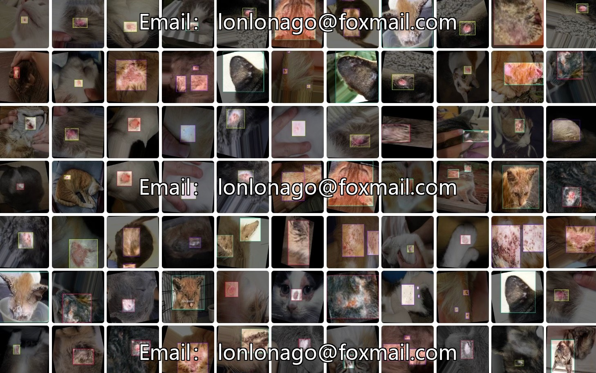
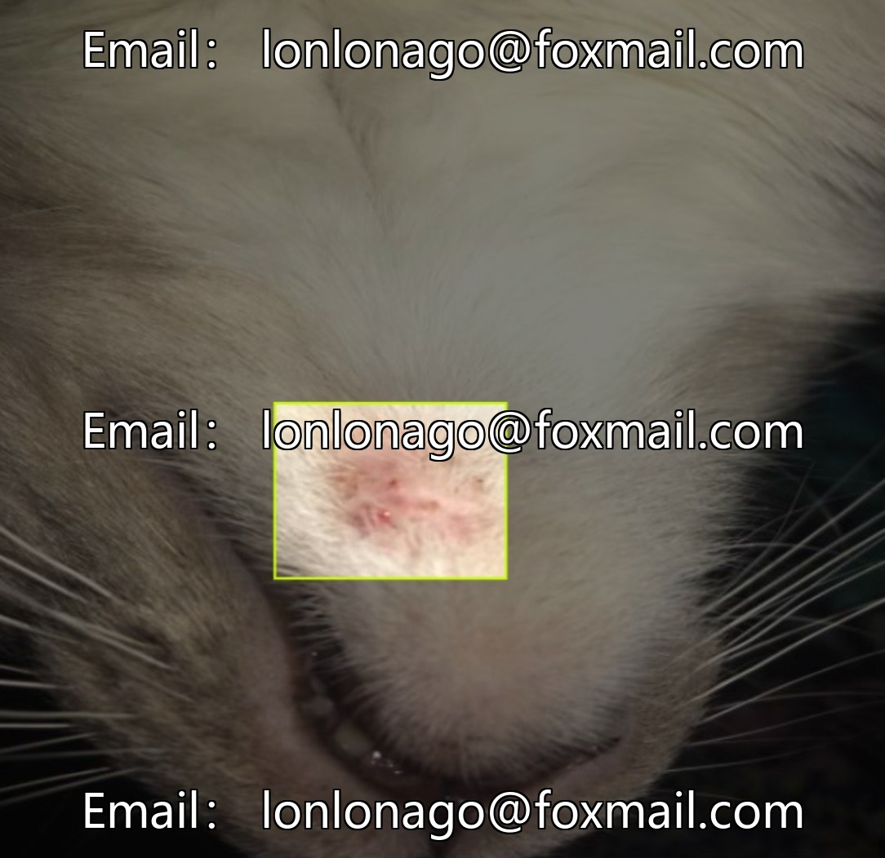
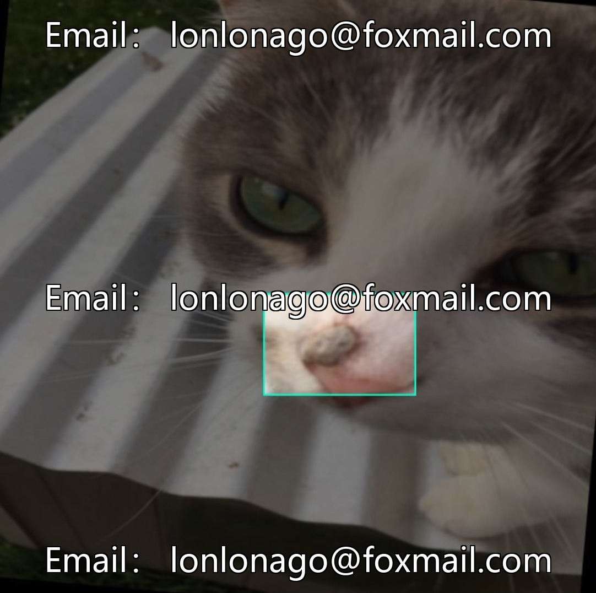
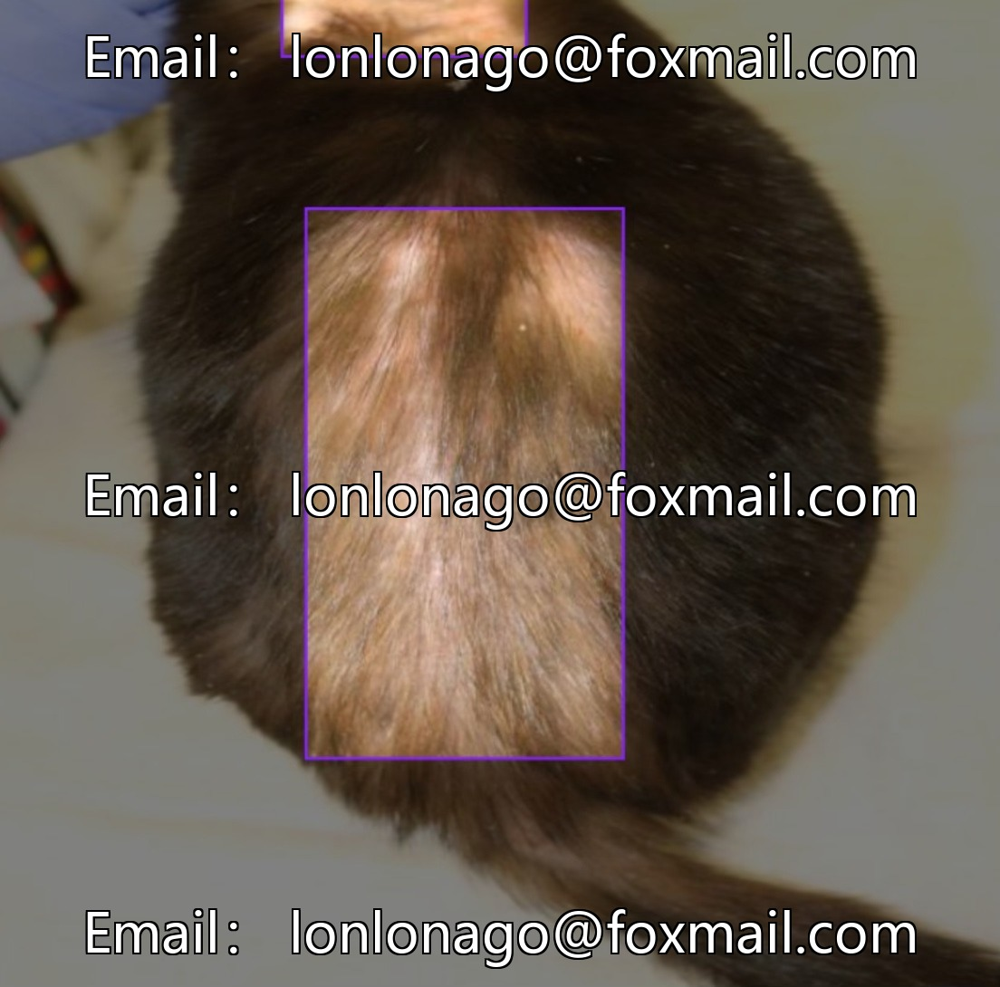

# Pet Dermatology Dataset

## Body

Pet Skin Disease Identification Dataset Based on Deep Learning - Improved Yolo Cat and Dog Skin Disease Image Recognition Dataset, Issue 10540, Supports the R&D of Pet Medical Intelligent Diagnosis Systems and the Development of Pet Health Management Platforms.

The dataset consists of 4 categories: Dermatitis, Flea Allergy, Ringworm, and Scabies, totaling 1600 labeled samples in YOLO format (image + txt annotations). The annotations include category ID, center point coordinates, and normalized width and height values. The data is abundant and covers common skin diseases in pets, suitable for model training and algorithm optimization.

Virtual materials, once sold, are non-refundable.
Interested friends, click "I want" to proceed.

## Images

## Payment

Here is a pay link on Stripe ( https://buy.stripe.com/3cs8yP7sY87d0vu9AB ). Please contact me lonlonago@foxmail.com after funding $89, and I will send you a complete data files , thank you!

